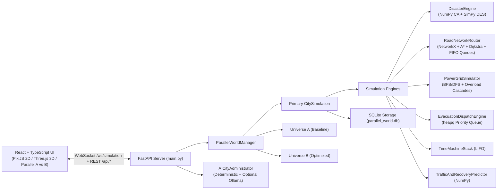

# System Architecture — Parallel World

## High-Level Data Flow

## Tick Execution Pipeline (`CitySimulation.step`)

1. **Disaster Cellular Automata + SimPy DES (`disasters.py`)**:
   - Advances `simpy.Environment` by `1.0` simulation minute and processes scheduled seismic/hydrological/thermal events.
   - Evaluates 4-neighbor Flood CA (elevation-aware hydraulic head) and Fire CA (combustibility & suppression).
2. **Power Grid Simulator (`power_grid.py`)**:
   - Computes station output under damage/flood/fault penalties.
   - Detects overloads; triggers cascading brownouts unless Load Shedding protects hospitals, shelters, and signals.
   - Runs explicit **BFS** (energized components) and **DFS** (critical facility reachability).
3. **Road Network & Multi-Agent Vehicles (`graph_router.py`, `simulation.py`)**:
   - Rebuilds weighted **NetworkX** road graph excluding flooded/blocked edges.
   - Steps commuters, ambulances, and fire trucks using **A\*** search and **FIFO intersection queues**.
4. **Emergency Dispatch & Evacuation (`evacuation.py`)**:
   - Ranks endangered tiles in a **`heapq` min-heap priority queue**.
   - Computes shortest safe evacuation corridors to shelters via **Dijkstra's algorithm**.
5. **Telemetry, ML Forecast & Time Machine (`ml_predictor.py`, `time_machine.py`, `storage.py`)**:
   - Computes City Stability, Citizens Affected, Services Active, and **NumPy** linear-trend forecasts.
   - Pushes a snapshot frame onto the **Time Machine LIFO Stack** and checkpoints every 5 ticks to **SQLite**.
